# P3_InterfacesInteligentes
## Diego García Hernández

## Situaciones

### Situación 1
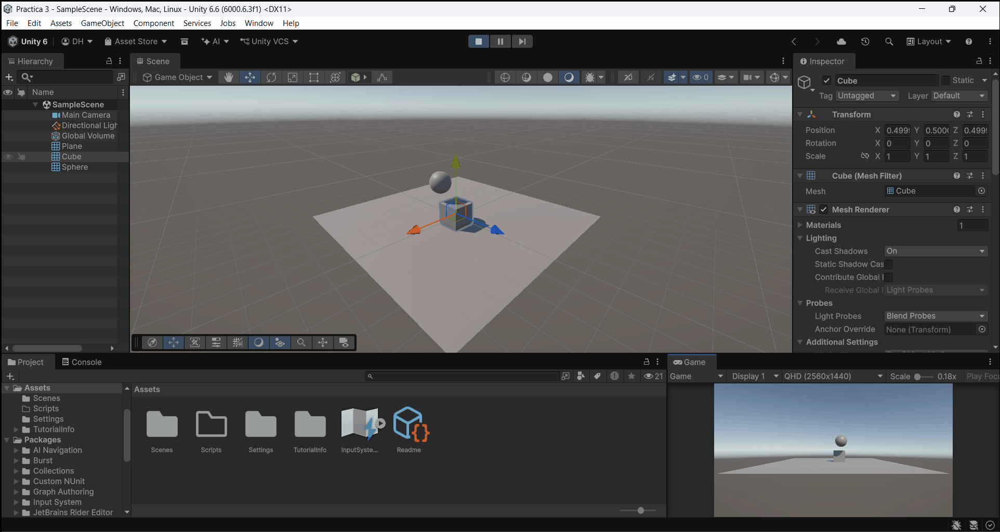

### Situación 2
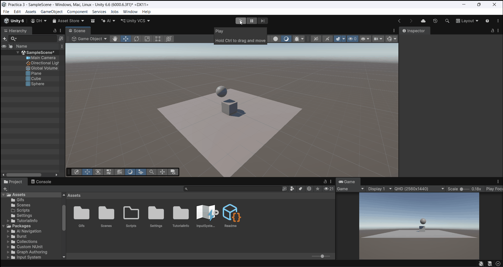

### Situación 3
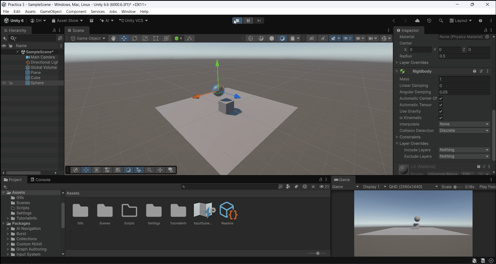

### Situación 4
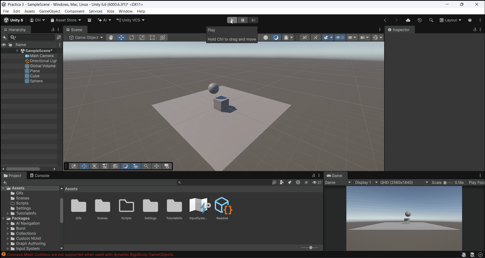

### Situación 5
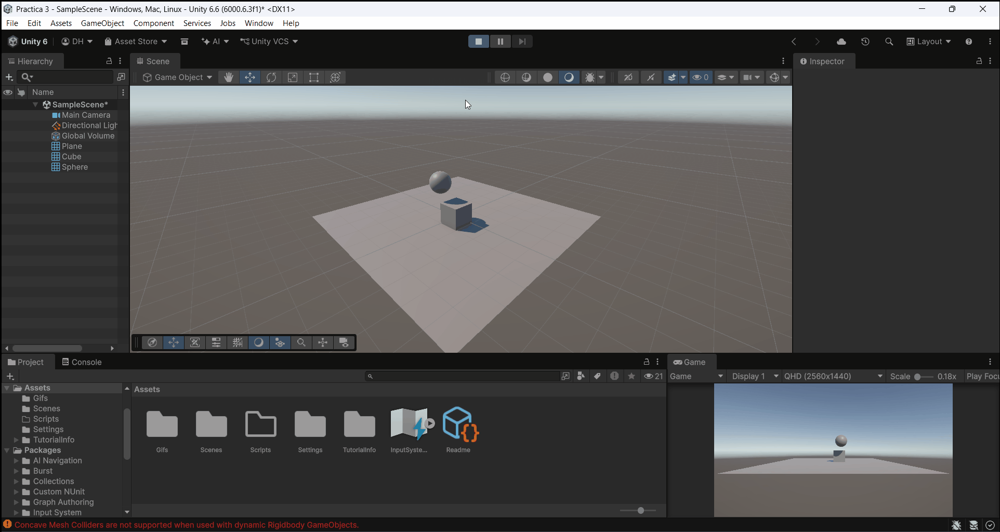

### Situación 6
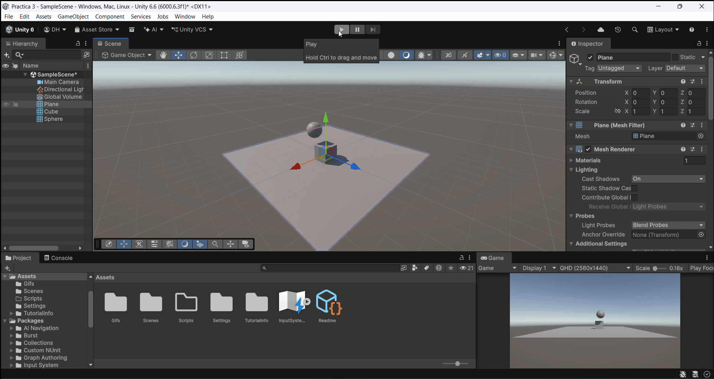

### Situación 7
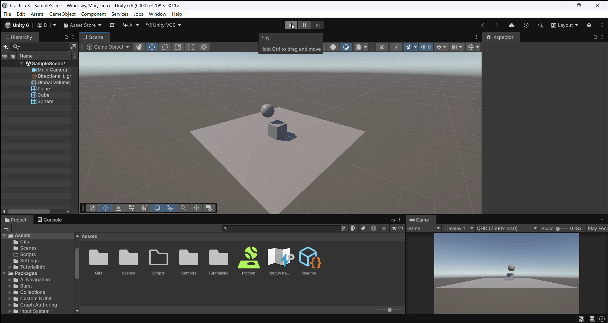

### Situación 8
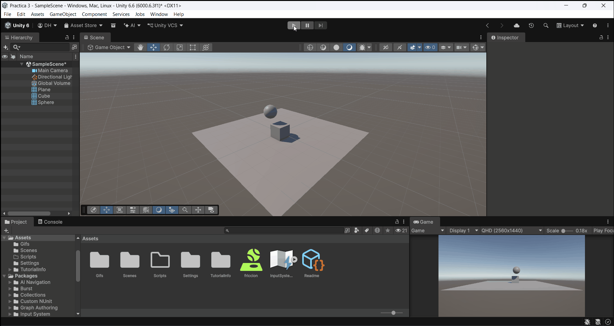

---

## Ejercicios

### Ejercicio 1
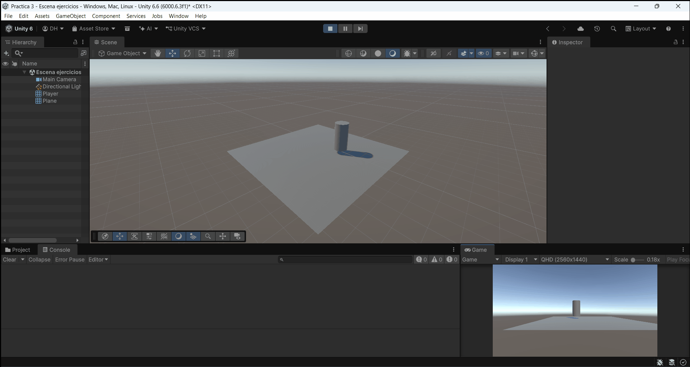

### Ejercicio 2
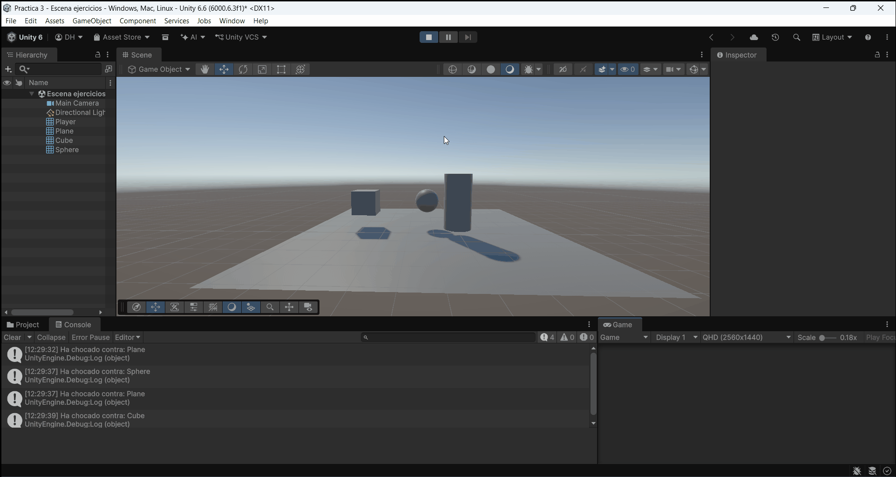

### Ejercicio 3
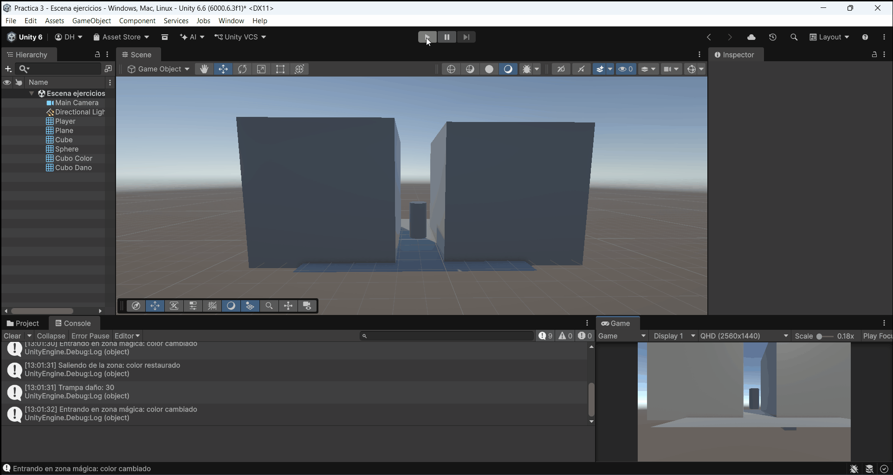

### Ejercicio 4
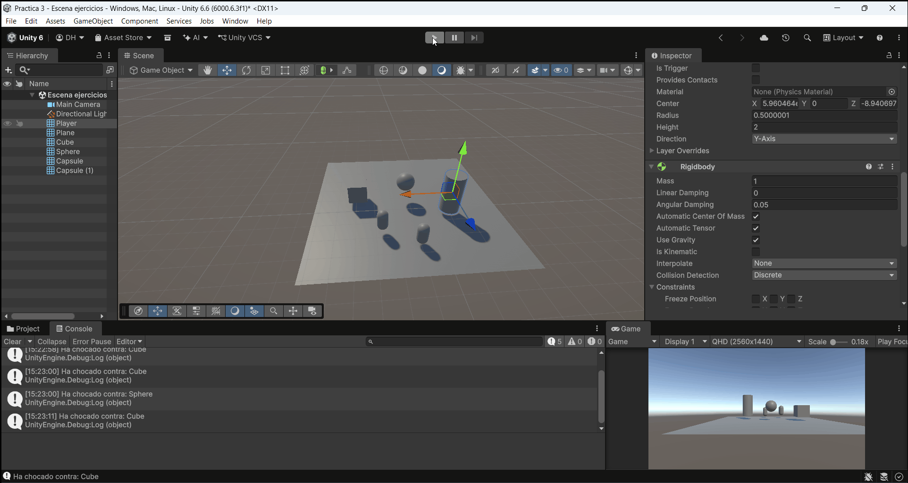

### Ejercicio 5
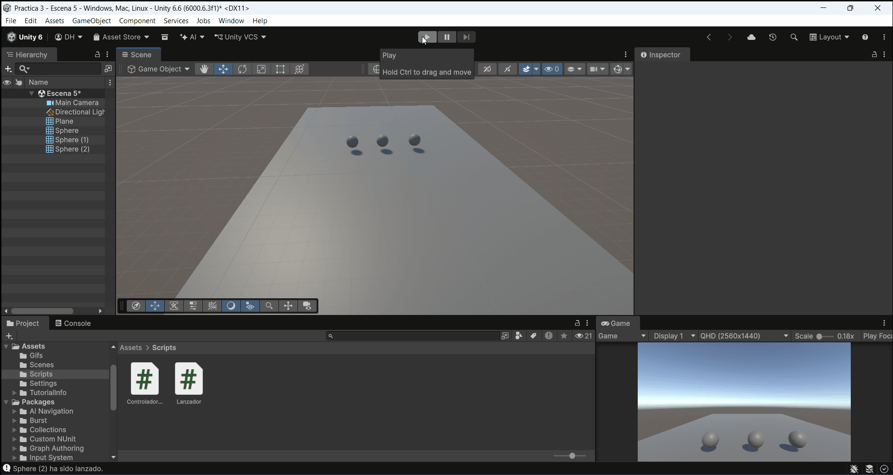

### Ejercicio 6
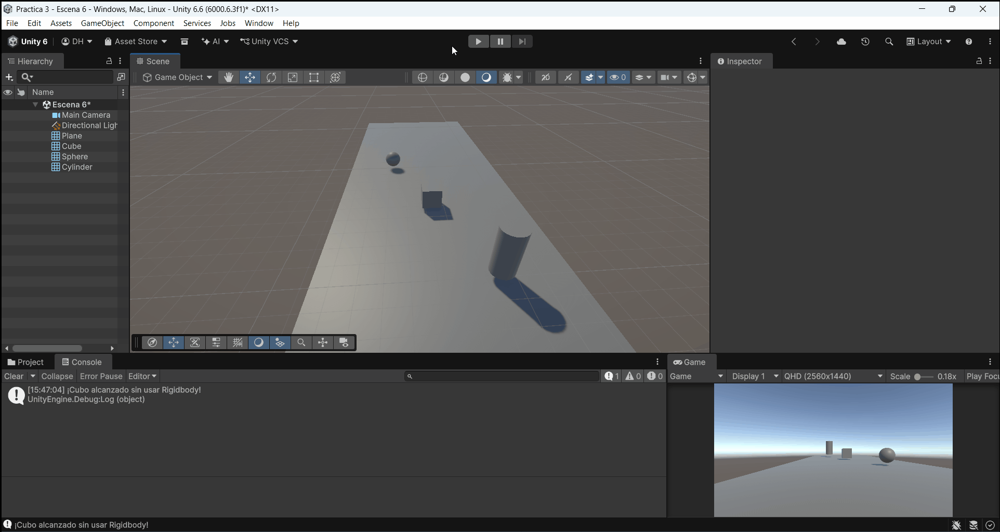
